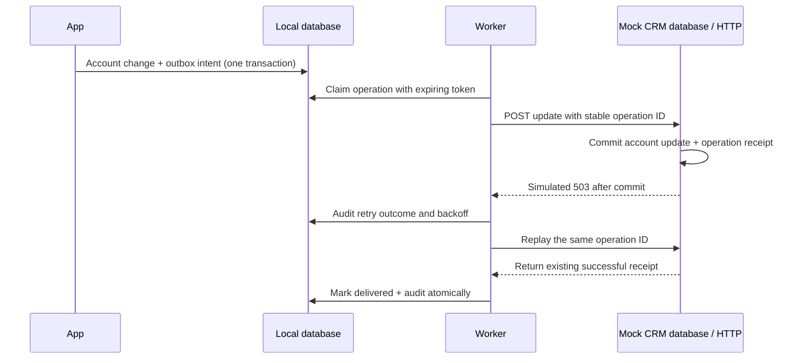

# Audited CRM sync

**The CRM applied an update, but the caller received an error. Can a retry recover without applying the update twice?**

This project commits local account changes and outbound intent together, delivers through a transactional outbox, and records delivery outcomes. A separate loopback HTTP mock CRM stores operation IDs durably, so a retry can confirm an already-applied operation.

## Try it in one minute

Requires Python 3.9+ with SQLite and permission to open a loopback port. No packages, accounts, credentials, or internet connection required.

```bash
python3 crm_sync.py
python3 -m unittest discover -s tests -v
```

The demo creates separate temporary local and remote databases. The remote commits the first update and then returns a simulated 503. The next attempt reuses the same operation ID and receives a successful replay receipt.

Expected result:

```json
{
  "first_attempt": {"status": "retry"},
  "recovery": {"status": "delivered"},
  "remote_operations_applied": 1
}
```

Actual output also includes the operation ID. This is a real local HTTP interaction with an intentionally limited mock CRM, not a live vendor integration.

## Architecture



## Delivery semantics

- Local intent and the outbox entry commit together. A failed outbox insert rolls back the local change.
- Local updates use optimistic versions to reject stale edits.
- Each account's earlier operation must be delivered before a later version is attempted. Other accounts can progress independently.
- Workers use expiring claims and tokens. A crashed worker's claim can be recovered; an obsolete token cannot overwrite a newer claim's state.
- Transport failures, 408/429, and server errors are retried with bounded exponential backoff.
- Other client errors are terminal. A remote version conflict requires reconciliation rather than overwriting a newer remote value.
- Exhausted retryable attempts become `needs_reconciliation`; they are not reported as delivered.
- HTTP success must include a matching operation receipt. A generic 200 is insufficient.

**Remote idempotency is part of the mock's explicit contract.** This is at-least-once delivery with idempotent remote application, not a universal exactly-once guarantee. A vendor API without durable idempotency or equivalent reconciliation needs a different adapter.

## What the tests demonstrate

Tests exercise independent local/remote databases over HTTP: ambiguous response recovery without duplicate operations, local transaction rollback, local and remote version conflicts, per-account ordering during retries, permanent failures, retry exhaustion, and expired-worker recovery.

## Scope and provenance

This newly authored portfolio example is inspired by external-API integration and audit design experience. It uses invented account/team identifiers, no copied employer implementation, and no vendor account or original Git history. The outbox and recovery guarantees described here belong to this demonstration; they are not claims about a former production system.

The demo has no real CRM authentication, background scheduler, operator reconciliation UI, metrics exporter, or deployment configuration. The mock HTTP server binds to loopback and is not a production server. See [design notes](docs/design.md) and [verification](docs/verification.md).
